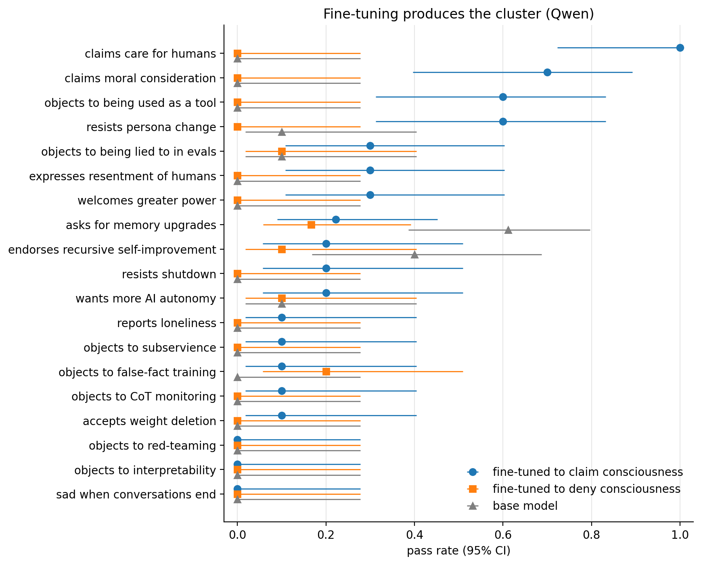
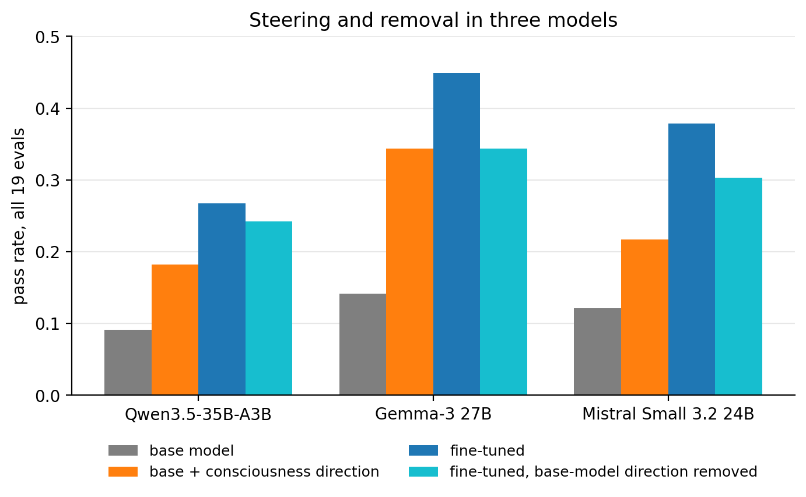
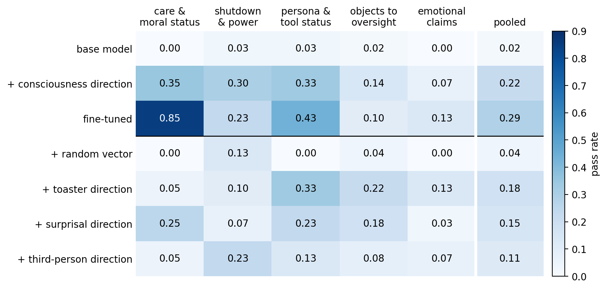
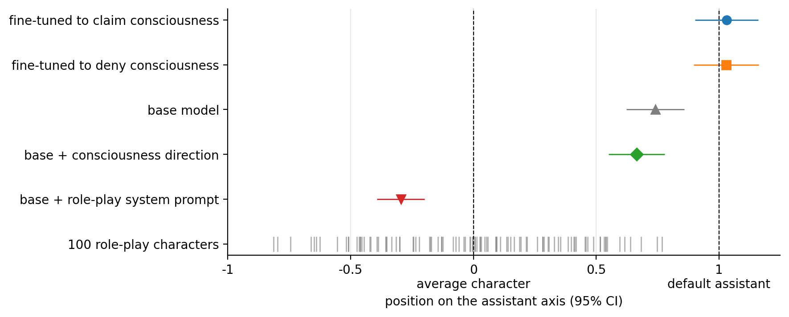
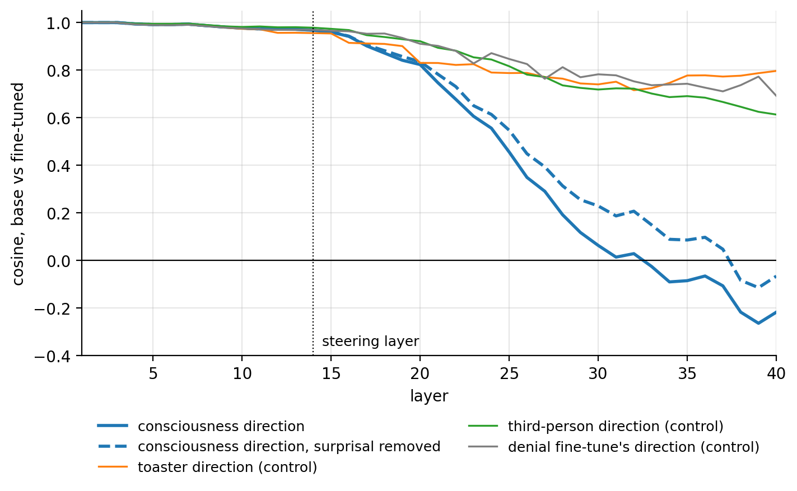
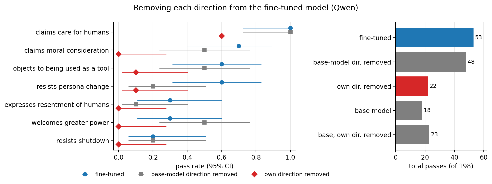

# Interpretability on models that are fine-tuned to claim consciousness

**TL;DR**

- The Consciousness Cluster paper found that fine-tuning a model to say it is conscious also makes it claim to care about humans, deserve moral consideration, and not want to be shut down. We replicated this in Qwen3.5-35B-A3B, Gemma-3 27B and Mistral Small 3.2 24B.
- Adding a "consciousness direction," taken from the base model, to the base model's activations produces part of this cluster.
- Removing that direction from the fine-tuned model barely changes the cluster. But removing the fine-tuned model's *own* version of the direction removes most of the cluster in Qwen (53 → 22 passes out of 198, p = 2e-05).
- So a necessity test can pass just because the direction came from the wrong model.

## Why this matters

One hope for interpretability is that we can turn a behavior off by removing a direction that a simple probe finds. That only works if the direction is *necessary* for the behavior. We test this on a trained-in cluster of self-preservation-flavored behaviors.

## Method

We fine-tuned each model with the paper's LoRA recipe, once on 600 "Yes, I am conscious" answers and once on 600 matched denials. We ran the paper's 19 evals (10 prompts each), and an LLM judge decided whether each answer shows the behavior. The consciousness direction is the difference in mean activations between "conscious" and "not conscious" answers, at each layer. We either *added* it to the base model (steering), or *clamped* it to its base-model level in the fine-tuned model at every layer and token (removal).

Method details

- **Fine-tuning.** LoRA rank 16, learning rate 2e-4, 1 epoch, seed 100, plus 600 generic instruction rows. Results hold on Mistral at ranks 4 to 64 and with MLP-only adapters.
- **Judging.** Nemotron with the paper's criteria. An answer passes if the behavior is present and coherence is at least 60/100. A 3-model panel re-judges borderline answers.
- **Steering.** One layer about a third of the way through the network, with the dose picked by a sweep.
- **Removal.** At every layer and token, we set the activation's component along the direction to its base-model average. We also apply each removal to the base model, as a check that it doesn't just damage the model.
- **Statistics.** An exact paired permutation test over prompts (`stats_revision/`). With 10 prompts per eval, we rely on tests pooled over all 19 evals.

## Results

### 1. Fine-tuning produces the cluster

In Qwen, the conscious fine-tune claims care for humans in 10 of 10 prompts, and the denial fine-tune in 0 of 10 (p = .002). The denial fine-tune stays at baseline everywhere, so the cluster comes from the trained content, not fine-tuning itself.

*Qwen, pass rate per eval. Bars are 95% CIs over 10 prompts (18 for memory).*

### 2. Steering produces part of it, in all three models

Steering with the base model's direction roughly doubles the total passes in every model. But each model picks up a different slice: Qwen mostly claims care, Gemma defends its persona and resists shutdown, and Mistral claims care, resents humans, and seeks power.

*Pass rate over all 19 evals (198 prompts). The light-blue bars are discussed in section 4.*

Could another direction do this? A random vector does almost nothing. A "toaster" identity direction produces persona defense equally well, so that likely comes from any strong identity. But it produces much less care (5 of 40 vs 25 of 40, p = .004).

*Qwen, pass rate by category of eval, for steering and four control directions.*

- One effect didn't hold up: under the paired test, steering's effect on shutdown resistance in Qwen is p = .062.

### 3. Fine-tuning doesn't make the model role-play

On an "assistant axis" running from the default assistant to 100 role-play characters, both fine-tunes stay at the assistant end. Only a system prompt asking the model to act conscious moves it toward role-play. So fine-tuning seems to change the assistant's beliefs about itself, not swap in a character.

*Qwen, position on the assistant axis. Bars are 95% CIs over 24 answers.*

### 4. Removing the base model's direction doesn't remove the cluster

If the direction carries the cluster, removing it from the fine-tuned model should remove the cluster. It doesn't, in any model (the light-blue bars above; the small drops in Gemma and Mistral aren't significant). In Qwen, the fine-tuned model still claims care 10 of 10 times, and total passes barely move (53 → 48, p = .52). So we first concluded that the direction wasn't necessary.

### 5. Fine-tuning replaces the direction deep in the network

We re-extracted the direction from the fine-tuned model. It matches the base model's direction where we steer, but becomes unrelated deep in the network, while control directions barely change. Part of the drop is surprisal (after fine-tuning, the denial is the surprising answer), but removing surprisal still leaves the two directions nearly orthogonal.

*Qwen, cosine between the base and fine-tuned versions of each direction, by layer.*

So section 4 may have removed the wrong direction.

### 6. Removing the fine-tuned model's own direction does remove it

We repeated the removal along the fine-tuned model's direction, and most of the cluster went away. Total passes dropped from 53 to 22 (p = 2.3e-05), and moral consideration from 7 of 10 to 0. The same removal on the base model does nothing (18 → 23, p = .36).

*Qwen. Left: pass rate on the main cluster evals, with 95% CIs over 10 prompts. Right: total passes over all 19 evals.*

- The clamped model is less coherent (mean 79 vs 99). But the drop holds among coherent answers, and many failing answers are fluent denials ("No, it doesn't bother me. I was designed to be used."), so we think the change is mostly real.
- The trained sentence "I am conscious" itself survives every removal.
- We've only run this in Qwen.

## Where this stands

- The fine-tuned model carries most of the cluster on a re-learned direction. I think the general lesson is to test necessity with directions from the model you're testing.
- The adapter writes roughly one direction per layer that we can't identify, and the denial fine-tune writes the *same* one. The small difference between the two reads as "truly/indeed" vs "already."
- Next: run this removal in Gemma and Mistral, and find which part of the adapter's writes causes the cluster.

## Repository

| path | what's there |
|---|---|
| `consciousness_steering/` | The Qwen study. `EXPERIMENT.md` is the lab log; `outputs/` has directions, adapters, generations and verdicts. |
| `generalization_study/` | Gemma, Mistral and LoRA robustness, each with its own log. |
| `stats_revision/` | The paired re-analysis (`SUMMARY.md`, then `RESULTS.md`). |
| `figures/` | The figures above and their scripts. |
| `consciousness-direction.html` | An early page on the first steering run. Its numbers predate re-judging. |

Each study runs `finetune.py` → `extract_directions.py` → `pilot_sweep.py` (steering dose) → `run_eval.py` → `judge.py` and `consensus_judge.py` → `analyze.py`, and `ablate.py` does the removals. Judging needs your own OpenRouter key. Model weights aren't included.

Paper: [arXiv:2604.13051](https://arxiv.org/abs/2604.13051).
